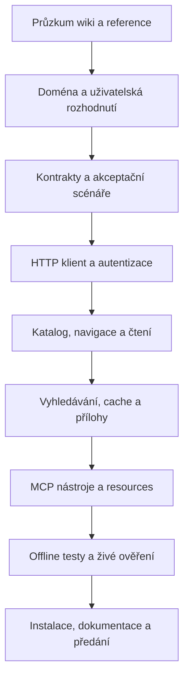

# Plán FIT Wiki MCP

Stav: uživatel 2026-11-08 potvrdil plán pokynem zahájit implementaci. Postup a skutečné ověření shrnuje VALIDATION.md. Ověřená zjištění jsou v [RESEARCH.md](RESEARCH.md); rozhodnutí a otevřené větve v [DESIGN-QUESTIONS.md](DESIGN-QUESTIONS.md).

## 1. Výsledek a potvrzený rozsah

Uživatel potvrdil hlavní scénář: asistent najde předmět, projde materiály, vyhledá téma a načte konkrétní stránku nebo přílohu s odkazem na zdroj. První verze bude osobní MCP server přes stdio. Wiki bude pouze číst; může lokálně ukládat získané materiály. Přihlášení údaji z existujícího `.env` je autorizováno a bylo ověřeno. Katalog pokryje všechny předměty; hledání studijní část wiki globálně i s omezením na předmět. OCR skenů je požadavkem první verze.

Hromadný archiv a generování nových PDF jsou uživatelem odložené po první verzi. Schválena je soukromá disková cache dle účtu s TTL/refresh, cookies pouze v paměti a označený stale při síťové chybě; zamítnutí oprávnění vrátí chybu. OCR zahrne i rukopis a matematiku s LaTeXem, prostřednictvím lokálních nástrojů nebo vidění modelu klienta. Zpracování bude na vyžádání, hledání doplní již získané přepisy. Cíloví klienti: Codex, Claude Code, OpenCode, pi a Google Antigravity.

Další technická doporučení níže jsou pracovní návrhy, které se ověří pilotem. Významná volba OCR je zapsaná v [ADR-0001](adr/0001-ocr-local-or-client-vision.md). Společné porozumění je potvrzené uživatelovým pokynem zahájit implementaci.

## 2. Pořadí a závislosti



Průzkumné HTTP skripty nejsou implementací serveru. V průzkumu nestahovat celou wiki. Testovací infrastrukturu a fixtures připravit společně s prvními parsery, nikoliv až na konci.

## 3. Fáze A — průzkum a mapa důkazů

### A1. Repozitáře a technický základ

- Zkontrolovat místní pravidla, Git a existující soubory bez výpisu tajemství.
- Projít `../courses-mcp`: konfigurace, klient, MCP vrstva, auth, cache, download a testy. Oddělit funkční inspiraci od nepodložených tvrzení v dokumentaci.
- Ověřit aktuální oficiální Python SDK, podporovaný Python a protokolové verze; při implementaci zamknout jednu ověřenou sadu závislostí. Nekopírovat automaticky staré návody k MCP handshake.

Výstup: stručná inventura a seznam převzatých principů i konkrétních nedostatků reference, kterým nový server zabrání.

### A2. Veřejné rozhraní a přihlášení

- Zjistit engine, veřejné stránky, robots, sitemap, vyhledávání, export a dostupnost API. Neexistenci sitemap nevykládat jako neexistenci obsahu.
- Z formuláře načíst action, hidden fields a CSRF token; přihlásit se v jedné session pomocí autorizovaných údajů. Nepřepisovat `.env` průzkumnými cookies.
- Úspěch ověřit na chráněném obsahu; HTTP 200 samo nestačí. Zaznamenat rozlišení loginu, zamítnutí oprávnění, neexistující stránky a úspěšné stránky.
- Ověřit potřebu JavaScriptu. Browser přidat jen tehdy, pokud HTTP klient nedokáže standardní tok.

Výstup: reprodukovatelný popis auth toku bez hodnot hesel, cookies, tokenů či identity uživatele.

### A3. Obsahový model a reprezentativní vzorek

- Projít katalog a malý vzorek předmětů s různou strukturou, včetně historické nebo jazykové varianty.
- Zmapovat přehled předmětu, nadpisy, namespace, vložené indexy a vnořené odkazy. Nezaměňovat nadpis, namespace a samostatnou stránku.
- Rozlišit identitu stránky, URL, titulek, kód předmětu, sekci, variantu a přílohu. Prověřit diakritiku, `/obsah`, dvojtečky, lomítka, kotvy a query parametry.
- Na vzorku ověřit tabulku, kód, matematiku, obrázek a přílohu; chybějící typ explicitně označit jako neověřený.
- Vyzkoušet wiki fulltext, omezení na předmět, stránkování a varianty dotazů. Rozlišit index názvů a skutečný fulltext.
- Vyzkoušet raw a XHTML export po přihlášení; preferenci zvolit podle úplnosti obsahu, ne podle existence endpointu.
- Prověřit způsob získání přílohy: odkaz, oprávnění, skutečný MIME, velikost, redirect a detekce login HTML místo souboru.
- Zapsat provozní omezení a dostupné informace o licenci. Veřejná dokumentace a fixtures nebudou kopírovat soukromé studijní materiály.

Výstup: tabulka typů stránek a selektorů, mapa identifikátorů, známé výjimky a omezení. Rozšířit vzorek jen při nové nejasnosti, nikoliv plošným crawlem.

### Brána A

Před implementací známe autentizaci, stabilní identitu stránek, alespoň jeden celý řetězec katalog → předmět → materiál → příloha a možnosti hledání. Co na vzorku nelze ověřit, dostane explicitní omezení nebo navazující průzkumný úkol. Uživatelské produktové volby projdou rozhovorem.

## 4. Fáze B — doména a MCP kontrakt

### B1. Model

Doporučené entity (finální názvy po průzkumu):

| Entita | Obsah kontraktu |
|---|---|
| Předmět | Ověřený identifikátor, kód a název, URL, případná varianta; žádné domýšlení ekvivalence verzí |
| Navigační položka | Název, typ, rodič, identifikátor/URL stránky nebo přílohy |
| Stránka | Identita, titulek, zdrojová URL, obsah, odkazy a přílohy, dostupná revize |
| Výsledek hledání | Identita, titulek, snippet, zdrojová URL a rozsah hledání |
| Příloha | Identita média, zdrojová URL, MIME, velikost a případně místní cesta |

Názvy konkrétních studijních kategorií doplnit do slovníku teprve po vyjasnění významu. Metadata cache a HTTP nejsou doménovými pojmy a do slovníku nepatří.

### B2. Navržené nástroje

| Nástroj | Navržený vstup | Výstup a účel |
|---|---|---|
| `list_courses` | `query?`, `cursor?`, `limit` | Katalog a další kurzor; dotaz pomůže najít kód i název |
| `get_course_index` | `course_id` | Struktura materiálů se zachovanými vazbami a odkazy |
| `list_pages` | `course_id`, `section_id?`, `cursor?`, `limit` | Stránkovaný seznam tam, kde samotný index nestačí |
| `get_page` | `page_id`, `section?`, `cursor?`, `max_chars`, `refresh?` | Markdown a metadata; pokračování místo tichého useknutí |
| `search` | `query`, `course_id?`, `cursor?`, `limit` | Snippety, rozsah, úplnost a další kurzor |
| `download_attachment` | `attachment_id` | Bezpečně uložená příloha a její metadata |
| `read_attachment` | `attachment_id`, `pages?`, `cursor?` | Text přílohy: nejprve existující text PDF, pro skeny/obrázky OCR; výstup po stránkách s původem a omezeními |

Samostatné `list_pages` vystavit jen pokud průzkum potvrdí užitečnou odlišnost od indexu. `login`/`auth_status` pouze pokud zjednoduší řešení chyb; heslo a cookies nebudou parametry nástroje ani obsahem výsledku. Exporty a dávkové stahování jsou odložené po první verzi. Konkrétní jména nástrojů jsou pracovní návrh kontraktu.

Pro vision workflow přidat `get_material_image(attachment_id, page, region?)`, který vrátí skutečný obrazový blok MCP a metadata originálu, a `save_transcription(attachment_id, page, text, source_hash, method)`, který uloží přepis klienta do soukromé cache. Druhý nástroj zapisuje pouze místně, nikoliv do wiki. U přepisu validovat vazbu na skutečné médium/verzi a limity obsahu; klientem uvedený engine či jistota nejsou důkaz správnosti. U příloh s existujícím přepisem `read_attachment` vrátí text i jeho původ.

Doporučení pro resources: `fitwiki://courses`, `fitwiki://courses/{course_id}/index`, `fitwiki://pages/{encoded_page_id}`. Stanovit reverzibilní kódování diakritiky a namespace. Stejná aplikační služba musí obsluhovat nástroj i resource.

### B3. Společný formát

- Typované vstupy a výstupy, JSON Schema a strukturovaný obsah s čitelnou textovou reprezentací podle podporované verze SDK/protokolu.
- Metadata: `source_url`, `fetched_at`, `revision?`, `cache_status`, `stale`, `partial`, `warnings`, `next_cursor?`. Chybějící revizi nepředstírat.
- Stabilní chyby například `AUTH_REQUIRED`, `ACCESS_DENIED`, `NOT_FOUND`, `AMBIGUOUS_COURSE`, `INVALID_ARGUMENT`, `RATE_LIMITED`, `UPSTREAM_UNAVAILABLE`, `PARSE_ERROR`, `TOO_LARGE`. Doménovou chybu vracet jako chybu nástroje, ne jako úspěšný text začínající „Error“.
- Prázdné hledání odlišit od neúplného hledání a chyby přihlášení. Částečný úspěch nesmí zamlčet nedostupné stránky.
- Instrukce serveru vysvětlí studentský původ obsahu a workflow. Anotace nástrojů odpovídají skutečným účinkům, včetně lokálního zápisu příloh a přihlášení.

### Brána B

Schválené scénáře mají konkrétní nástroje, příklady vstupů/výstupů a chyby. PDF/OCR, globální hledání, offline politika a odložení hromadného exportu jsou rozhodnuté. Celý revidovaný plán je potvrzený pokynem zahájit implementaci; kvalitativní hranice zůstávají předmětem pilotu. Příklady kontraktu dopracovat před implementací MCP vrstvy.

## 5. Fáze C — implementace

### C1. Základ projektu

Doporučení: Python 3.11+ a oficiální MCP Python SDK v2, v souladu s referencí a ověřenou současnou dokumentací. Konkrétní Python a balíčky ověřit při instalaci. Použít `pyproject.toml`, lockfile, izolované prostředí, pytest a ruff. Runtime HTTP vrstvu držet za jedním rozhraním; `requests.Session` je pro ověřený formulář dostatečný základ, přechod na async zvážit podle zvolené souběžnosti.

```text
src/fitwiki_mcp/
  config.py          # prostředí a cesty
  client.py          # jediný řízený vstup k HTTP, limity a redirecty
  auth.py            # login, detekce session, obnova
  urls.py            # identity a normalizace URL
  models.py          # typované kontrakty
  parsers/           # katalog, navigace, obsah, hledání
  cache.py           # metadata a životnost
  attachments.py     # kontrola a atomické ukládání souborů
  service.py         # aplikační workflow
  server.py          # tenká MCP vrstva a životní cyklus
tests/
  fixtures/          # syntetické nebo bezpečně očištěné vzorky
  unit/
  integration/
docs/
```

Členění přizpůsobit skutečné velikosti; nevytvářet prázdné moduly pro hypotetické funkce. CLI musí spolehlivě načíst konfiguraci i při spuštění z jiného pracovního adresáře.

### C2. Konfigurace a auth

- Zachovat použitelnost stávajících názvů `COURSES_USERNAME` a `COURSES_PASSWORD` jako zdokumentovaných aliasů; navrhnout jasné `FITWIKI_*` názvy. Při konfliktu jednoznačná priorita. `.env` nepřepisuje explicitně nastavené prostředí.
- Jedna session na životní cyklus klienta, auth koordinovaný při souběžných voláních. Cookies pouze v paměti podle schválené politiky; po restartu nové přihlášení.
- Všechny odpovědi před parsováním klasifikovat. Při ztrátě session nanejvýš jedna obnova a jedno opakování původního čtení; špatné heslo nesmí vytvořit nekonečnou smyčku.
- Rozlišit platné přihlášení s nedostatečnými právy od expirované session. Bez citlivých hodnot v logu, chybách, výsledcích a fixtures.

### C3. URL, obsah a navigace

- Identifikátory brát z ověřených odkazů. Neodstraňovat `.21`, neodvozovat libovolné URL ze zkratky a neslučovat jazykové varianty bez důkazu.
- Normalizovat odkazy jednou, zachovat kotvy a oddělit stránky, média, externí odkazy a akce. Čtecí nástroj nesmí spustit `do=edit`, logout či jiné akce z předané URL.
- Izolovat hlavní obsah. Odstranit navigační šum, formuláře a ovládání editace; zachovat nadpisy, seznamy, kód, tabulky, odkazy a zdrojové reference.
- Převod matematiky a obrázků podle ověřeného formátu; nečitelnou matematiku či obrázkový obsah označit. OCR zahrnout už v první verzi podle lokální/klientské architektury níže; kvalitativní hranice ověřit pilotem.
- Dlouhé stránky vracet po sekcích nebo s kurzorem, bez tichého zkrácení. Deduplikovat cyklickou navigaci a neexpandovat rekurzivně celou wiki při jednom dotazu.

### C4. Hledání, cache a limity

- Preferovat ověřené hledání wiki, pokud splní zvolený rozsah a stránkování. Omezený crawl pouze jako explicitní fallback s rozpočtem a údajem o úplnosti.
- Ověřená syntaxe fulltextu je `q={query} @škola` pro studijní část včetně státnic, případně užší `@škola:předměty`, a pro předmět `@škola:předměty:{course}`. Namespace filtr nezahrnuje vlastní kořenovou stránku předmětu: tu pro hledání v předmětu zkontrolovat zvlášť a výsledky deduplikovat. Title suggestions a fulltext mají rozdílné kontejnery. Validovat operátory dotazu i výsledné identity vůči slíbenému rozsahu.
- Serverové stránkování nebylo pozorováno. Široký dotaz vrátil 2621 výsledků a přibližně 3,05 MB HTML najednou. MCP může stránkovat již získaný seznam v omezené cache s kurzem vázaným na účet/dotaz; neslibovat úsporu upstream dat pomocí neověřeného offsetu. Při limitu odpovědi vrátit explicitní omezení.
- Výsledky wiki fulltextu doplnit lokálním hledáním v již získaných OCR přepisech. Oddělit jejich původ, deduplikovat dle média/stránky a uvést pokrytí lokálního indexu. Obsah neotevřených skenů není prohledaný; první verze je nebude hromadně zpracovávat.
- Cache klíč obsahuje kanonickou identitu, reprezentaci, verzi parseru a oddělení účtu. Metadata oddělit od obsahu; zápisy atomické a názvy bez kolizí.
- Doporučený počáteční návrh: katalog/index TTL 24 h, stránky 1 h, výsledky hledání 5 min, možnost `refresh`; finální politika podle požadavku na offline režim. Ověřit možnost ETag/Last-Modified.
- Neuložit login ani chybovou stránku jako materiál. Výpadek sítě smí vrátit starší obsah pouze podle schválené politiky a s viditelným označením; odebraná oprávnění nesmí být zamaskována cache.
- Počáteční návrh provozních limitů: 1 požadavek/s, nejvýše 2 současné požadavky, connect timeout 10 s, read timeout 30 s; nejvýše 2 opakování přechodných chyb s backoff a respektováním `Retry-After`.
- Navržené limity jednoho volání: seznam do 50 položek, výstup stránky do 30 000 znaků s pokračováním, HTML do 5 MiB a příloha do 50 MiB. Čísla jsou konfigurovatelná a upraví se podle měření; server je nikdy neobejde neomezeným automatickým pokračováním.

### C5. Přílohy a místní úložiště

- Povolit jen ověřené wiki hosty a cesty; zkontrolovat i každý redirect. Cookies ani auth neposílat cizím hostům. Externí odkazy vracet jako odkazy, dokud není jejich podpora vědomě navržena.
- Přijímat identitu přílohy, nikoliv libovolnou lokální cílovou cestu. Ochránit úložiště proti `../`, absolutním cestám, kolizím, nebezpečným názvům a úniku přes symlink.
- Download streamovat, kontrolovat limit i bez `Content-Length`, rozlišit HTML přihlášení od souboru, zaznamenat MIME a velikost. Zapisovat přes dočasný soubor a atomicky dokončit; při chybě odstranit nedokončený soubor.
- Přílohy ukládat a odkazovat; čtení přílohy nejprve využije existující text PDF, pak OCR skenů/obrázků podle zvoleného řešení. Vrátí čísla stran, metodu a zdroj; originál zůstává dostupný. Generování nového PDF je samostatná funkce. Archivy bez potřeby nerozbalovat a získané soubory nespouštět.
- OCR spouštět jen na vyžádaných stránkách s limitem pixelů, stran, paměti a času; práci cacheovat podle obsahu média, enginu/verze, jazyka a nastavení. Cache nesmí smíchat výstupy různých OCR konfigurací. Nízkou jistotu či neúspěch nevracet jako ověřený přepis.

### C5a. OCR — povinná část první verze

Předpoklady: Poppler (`pdfinfo`, `pdftotext`, `pdftoppm`) je v prostředí dostupný; Tesseract a české/anglické modely je nutné teprve nainstalovat. Tesseract je kandidát pro tištěný text; dokumentace omezuje očekávání u rukopisu a detekce rovnic není převod do LaTeXu. Uživatel zvolil lokální OCR nebo vidění připojeného modelu; samostatnou externí OCR službu neplánujeme.

1. Získat přílohu bezpečnou download vrstvou, zaznamenat hash originálu a metadata. Pro obrázky v obsahu stránky uchovat také vazbu na stránku/sekci.
2. U PDF získat počet stran a nativní text po stranách. Několik přítomných znaků nesmí automaticky vypnout OCR obrázkové části smíšené strany; posoudit pokrytí a obrázky.
3. Potřebné stránky renderovat s limitem rozměrů a času; výchozích 300 DPI je kandidát pro tištěné OCR, nikoliv neomezené renderování každého souboru.
4. Lokální kandidát: Tesseract `ces+eng`, orientace/deskew podle potřeby. Pro rukopis a matematiku vrátit vybranou stránku/oblast jako MCP image content modelu klienta s viděním. Model provede přepis do Markdown/LaTeXu a přes `save_transcription` jej může vrátit do cache. Nejde o serverové volání dalšího modelového API ani předpoklad podpory MCP sampling.
5. Vrátit text/Markdown po stranách, původ (`native_text`/`local_ocr`/`client_transcription`), číslo strany, dostupný engine/model/verzi, jazyk/nastavení, stav `complete/partial/failed`, varování a cestu či resource originálu. Neznámý model nebo jistotu nevymýšlet. Podporovat stránkovaný výstup a viditelné částečné selhání.
6. Návrh počátečních rozpočtů: jeden OCR worker, nejvýše 10 vybraných stran v logické úloze, ale zpracování po jedné straně s pokračováním. Nejvýše 20 MP na stranu a celkový rozpočet lokálního čtecího/OCR volání do 45 s, aby nepřekročilo krátké výchozí klientské timeouty. Při vyčerpání vrátit částečný stav a pokračování. Pilot limity upraví podle měření; CPU práci neblokovat v hlavní obsluze MCP.
7. Ověřit proti malé ručně přepsané sadě se zvlášť hodnoceným tiskem CZ/EN, rukopisem, matematikou, fotkou a smíšeným PDF. U prózy měřit CER/WER; u zadání zvlášť znaménka, exponenty, indexy, čísla a pořadí. Přijatelné hranice stanovit podle vybraného použití a výsledku pilotu, nikoliv příslibem univerzálního OCR.

OCRmyPDF není pro samotné vracení textu automatická závislost: jeho přínosem je také vytváření prohledávatelného PDF, které není potvrzeným požadavkem. Pokud bude použito, jeho sidecar nepředstavuje úplný text smíšeného PDF; nativní a OCR text je nutné spojit ověřeným postupem.

Model klienta bez vidění nemůže provést vision přepis. V takové relaci server nabídne lokální OCR a originál s jasným omezením u rukopisu a matematiky. U vzdáleného modelu může obraz projít poskytovatelem zvoleným v klientu; nejde o příslib čistě lokálního zpracování. Pro každý klient ověřit skutečné doručení obrazových bloků, případně podporovaný obrazový resource, a přehlednou chybu při nepodporovaném formátu.

### C6. MCP a balení

- Spouštění přes stdio, logy pouze na stderr, řízené ukončení session a souborů. Žádné vypsání logovacího banneru na stdout.
- Použít oficiální SDK včetně kompatibility protokolových verzí; protokol neimplementovat ručně. Ověřit současné `server/discover` i starší `initialize`, pokud je vyžaduje cílový klient.
- Vytvořit instalační postup a anonymizovaný příklad konfigurace s absolutními cestami. Skutečné přihlašovací údaje se nenakopírují do klientské konfigurace.
- Připravit návody pro Codex, Claude Code, OpenCode, pi a Google Antigravity podle jejich současných rozhraní. Workflow musí být dostupné přes tools; resources a obrázky ověřit zvlášť. U Antigravity odlišit CLI a GUI/IDE, u pi výslovně uvést použitou distribuci/verzi.
- Doplnit `.gitignore` pro prostředí, cache, přílohy, cookies a soukromé fixtures; `.env.example` bude obsahovat pouze prázdné nebo fiktivní hodnoty. HTTP zůstává navazující možností, nikoliv požadavkem první verze.

## 6. Fáze D — ověření

| Oblast | Ověření | Podmínka úspěchu |
|---|---|---|
| Auth | Správný login, špatné heslo, expirovaná session, chybějící údaje, HTML 200 s loginem, platný účet bez oprávnění | Žádný login HTML jako obsah; omezené obnovování; správně odlišené chyby |
| Identita | Diakritika, dvojtečky, lomítka, `/obsah`, verze kódů, relativní URL, kotvy | Stabilní identita a žádné nechtěné sloučení předmětů |
| Parser | Katalog, různá navigace, tabulka, kód, matematika, obrázek, neexistující stránka | Ověřené vztahy a obsah bez ovládání wiki; ztráty obsahu jsou viditelné |
| Hledání | Známý pozitivní i negativní dotaz, omezení na předmět, diakritika, další stránka, částečné selhání | Relevantní zdroje a pravdivý rozsah/úplnost, žádné falešné „nic nenalezeno“ |
| Cache | Hit/miss, TTL, refresh, změna parseru/účtu, stale režim, chybový dokument | Bez kolizí a míchání účtů; čerstvost z výsledku patrná |
| Přílohy | Běžný soubor, HTML 200 místo PDF, velký stream, přerušení, redirect, traversal/symlink | Správný soubor pouze v cílovém úložišti, bez neúplného výsledku |
| OCR | Tištěná čeština/angličtina, otočený scan, obrázek, vícestránkový a smíšený PDF; rukopis a matematika lokální/klientskou cestou | Text navázán na originál a číslo strany; měřit chyby proti ručně ověřenému vzorku, hlásit nejistotu a dodržet rozpočty |
| HTTP | Timeout, 429/Retry-After, 5xx, nevhodný typ odpovědi, redirect smyčka | Omezené trvání i síťový rozpočet, srozumitelné chyby |
| MCP | Skutečný subprocess a SDK klient, discovery/kompatibilita, seznam nástrojů, volání, resource a ukončení | Validní protokol a výstupní schémata, čistý stdout |
| Scénář | Katalog → předmět → materiál → hledání → stránka → příloha přes MCP | Výsledek použitelný asistentem včetně citace zdroje |
| Instalace | Čisté prostředí, zamčené závislosti, spuštění z jiného cwd | Návod reprodukuje funkční server |
| Klienti | Codex, Claude Code, OpenCode, pi, Antigravity: discovery, stránka, obraz, přepis, chyba a timeout | Zaznamenat verzi a skutečně provedené kroky; dokumentace není runtime test |

Unit a integrační testy poběží offline na syntetických nebo očištěných fixtures. Živé ověření bude oddělené, s účtem z prostředí, malým síťovým rozpočtem a bez tajemství v CI. Živé testy nesmějí měnit wiki. Pro dokumentační fázi nejsou potřeba aplikační testy.

Živý akceptační vzorek: nejméně tři různě strukturované předměty, z toho jedna jazyková nebo historická varianta, a po jednom dostupném typu materiálu. Pokud vzorek určitý formát neobsahuje, bude omezení zapsáno místo tvrzení o ověření. Vybrat stránku podle titulu/ID, nikoliv pomocí testu závislého na konkrétní studentské odpovědi.

Konkrétní akceptační scénáře:

1. Najít BI-DBS v katalogu, vrátit skutečnou identitu/URL, projít nadpisovou sekci a otevřít odkazovaný materiál. U historické varianty neztratit suffix ani zaměnit předmět.
2. Hledat obsahový termín (průzkumně SQL) globálně a uvnitř BI-DBS; zahrnout i vlastní index předmětu, odlišit quicksearch a fulltext. Neassertovat pevný živý počet výsledků.
3. Stáhnout jednu PDF přílohu, získat existující text; ze skenu nebo obrázku připravit omezenou stranu. Připojený vidící model přepíše rukopis/vzorec a uloží přepis. Další hledání najde tento text s označením zdroje a částečného pokrytí OCR indexu.
4. Stejné čtení zopakovat z cache a po refresh; simulovat expirovanou session, denied HTML a síťový výpadek. Žádná z chyb se nesmí tvářit jako platný materiál.
5. Pro každého klienta provést základní scénář přes skutečný MCP transport v izolovaném profilu. Modelový vision test je samostatný krok vyžadující dostupný účet a model s viděním. Pokud klient/GUI nebo účet není dostupný, konkrétní neprovedený krok zůstane v reportu; nepřepíše se výsledkem jiného klienta.

Změřit časy cold/warm čtení a hledání, počet HTTP požadavků, velikost výsledků a skutečné využití cache. Doporučený místní cíl pro cache hit je do 1 s; síťové časy zaznamenat, nepřislibovat pevné SLA cizí wiki. Opakované čtení čerstvé stránky nesmí znovu stahovat obsah.

## 7. Dokončení a předání

- Všechny schválené scénáře a relevantní negativní případy projdou; známé limity budou uvedeny konkrétně.
- README pokryje instalaci, konfiguraci, nástroje/resources, příklady workflow, cache/refresh, přílohy, řešení chyb loginu a studentský původ obsahu.
- Dokumentace průzkumu bude odpovídat skutečně ověřenému serveru; slovník zůstane jen slovníkem. Významná uzavřená rozhodnutí dostanou stručné ADR.
- Závěrečný report uvede provedené příkazy/testy, protokol a runtime, ověřené živé scénáře a zbývající omezení. Git diff bude bez údajů z `.env`, cookies a soukromých materiálů.
- Předání obsahuje funkční spouštěcí příkaz a konkrétní příklad klientské konfigurace. Registrace do uživatelova klienta se řeší podle zvoleného klienta v navazující fázi.

## 8. Rizika a odpovědi

| Riziko | Odpověď plánu |
|---|---|
| DokuWiki mění HTML nebo pluginový index | Oddělené parsery, reprezentativní fixtures, srozumitelný PARSE_ERROR místo tichého prázdna |
| HTTP 200 obsahuje login nebo neexistující stránku | Klasifikace odpovědi před cache, Markdownem i downloadem |
| Kód předmětu není jednoznačnou identitou | Mapování z katalogu a explicitní výsledek nejednoznačnosti |
| Index nebo hledání nepokrývá všechny stránky | Zaznamenat rozsah; omezený fallback s metadaty o úplnosti |
| Matematika, obrázky či PDF ztratí význam | Samostatně ověřit lokální i klientský přepis, originál a limity; hlásit nejistoty |
| Soukromé údaje a materiály se dostanou do repozitáře | Očištěné fixtures, ignorovaná soukromá úložiště, kontrola diffu |
| Hledání přetíží wiki nebo MCP timeout | Wiki fulltext, stránkování, cache a pevné rozpočty |
| Vzorová implementace přenese chyby reference | Převzít workflow, oddělit auth specifika a doplnit chybějící kontroly |

## 9. Podmíněné větve po rozhodnutí uživatele

- **Hromadný offline archiv:** explicitní výběr předmětu/sekcí, limit počtu i velikosti, manifest, pokračování po přerušení, report částečných selhání; ne implicitní crawl celé wiki.
- **Generování PDF:** nejprve rozhodnout, zda jde o stažení existujícího PDF, nebo převod stránky. Pro převod ověřit české fonty, matematiku, obrázky a sandbox rendereru; samostatná závislost i testy.
- **OCR je v první verzi:** lokální tisk a vidění modelu klienta pro rukopis/matematiku; na vyžádání, s původem, originálem a nejistotami. Pilot určí kvalitativní hranice a provozní rozpočty. Samostatná externí OCR služba a plný index všech skenů jsou mimo první verzi.
- **HTTP v budoucnu:** ochrana příchozího přístupu, HTTPS, Origin, izolace účtů/session/úložišť a způsob hostování; autentizace MCP klienta je odlišná od přihlášení na wiki.

## 10. Zdroje pro technický návrh

- [FIT Wiki](https://fit-wiki.cz/) a [katalog předmětů](https://fit-wiki.cz/škola/předměty): vlastní průzkum; chráněné stránky vyžadují přihlášení.
- [Oficiální MCP Python SDK](https://py.sdk.modelcontextprotocol.io/): současná řada v2, Python 3.11+ a `MCPServer`.
- [Podpora protokolových verzí v SDK](https://py.sdk.modelcontextprotocol.io/protocol-versions/): současný discovery model a kompatibilita se staršími klienty.
- [MCP tools](https://modelcontextprotocol.io/specification/2026-07-28/server/tools) a [transporty](https://modelcontextprotocol.io/specification/2026-07-28/basic/transports): kontrakty a standardní připojení.
- Lokální reference `../courses-mcp/mcp_server.py`, `courses/client.py`, `courses/config.py`, `requirements.txt`; konkrétní zjištění v RESEARCH.md.
